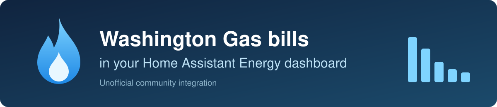
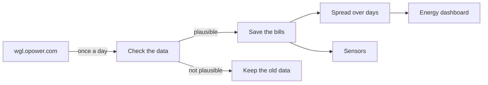

  

  
  
  
  

# Washington Gas for Home Assistant

> [!NOTE]
> **This is not an official integration.** It is an independent project, not affiliated with or
> endorsed by Washington Gas, WGL or Oracle. It is maintained as best effort and stops working if
> the site changes.

Brings your Washington Gas **usage and cost** from [wgl.opower.com](https://wgl.opower.com) into
Home Assistant's Energy dashboard, including your past bills.

**[Features](#features) · [Compatibility](#compatibility) · [Install](#installation) · [Configure](#configuration) · [Entities](#entities) · [FAQ](#faq) · [Privacy](#privacy-and-security)**

---

## Features

- 📊 **Energy dashboard**: gas usage and cost as long-term statistics
- 🕰️ **History**: imports the bills the portal still has, then keeps them
- 📅 **Spread by day**: each bill is divided evenly over its days
- 🏠 **Several accounts**: supports more than one gas account per login
- 🔁 **Self-correcting**: a revised bill updates the totals without double counting
- 🔒 **Read-only**: no device control, no open ports

> [!IMPORTANT]
> **This is bill data, not live usage.** The portal served one read per bill on the account this was
> built with. Daily bars are averages, and totals near bill dates are approximate.

## Compatibility

| Account | Status |
|---|---|
| One gas account, billed in therms | ✅ Confirmed working |
| Several gas accounts on one login | 🧪 Automated tests only |
| Other Washington Gas service areas and rate plans | ❔ Likely, untested |
| Logins that ask for a verification code | ❌ Not supported |

Tried it? [Open an issue](https://github.com/skontzias1/washington-gas-ha/issues) and say how it went.
Please leave out your login, account number and bills.

---

## Installation

### Via HACS (recommended)

1. Click the button, or open **HACS → ⋮ → Custom repositories** and add
   `https://github.com/skontzias1/washington-gas-ha` as type **Integration**.
2. Download **Washington Gas (unofficial)**.
3. Restart Home Assistant.

<b>Manual install</b>

1. Download this repository (**Code → Download ZIP**).
2. Copy `custom_components/washington_gas/` to `/config/custom_components/washington_gas/`.
3. Restart Home Assistant.

## Configuration

First create a login at [wgl.opower.com](https://wgl.opower.com). It is separate from the
My Washington Gas login. Use a password you use nowhere else.

1. Click the button, or go to **Settings → Devices & services → Add integration → Washington Gas**.
2. Enter your wgl.opower.com email and password.

### Add it to the Energy dashboard

1. Under **Gas**, choose **Add gas source**.
2. For usage, choose **Washington Gas consumption**.
3. For cost, choose **Use an entity tracking the total costs**, then **Washington Gas cost**.

New installs include a short account code in those names.

### Options

| Option | Default | What it does |
|---|---|---|
| Unit the portal reports | therm | Compare one bill with the site, and switch to CCF if it doesn't match |
| Therms per CCF | 1.04 | Converts therms to CCF. An approximation: use the factor on your bill. Cost is not affected |

---

## Entities

| Sensor | Example | Notes |
|---|---|---|
| Last bill usage | `25.0 therm` | |
| Last bill cost | `$55.00` | As the portal reports it. On the tested account, the whole bill including fixed charges |
| Last bill average rate | `2.2 USD/therm` | Cost ÷ usage, so fixed charges count |
| Last bill start | `2026-01-05` | |
| Last bill end | `2026-02-03` | |

Examples are made up.

## How it works

## FAQ

<b>Why isn't there a bar for today?</b>

Data arrives with each bill. The current billing period appears after Washington Gas posts it.

<b>Why is every day the same?</b>

The portal served only bill totals, so each bill is split evenly over its days.

<b>What happens if the site is down or my password changes?</b>

During an outage your history and last values stay, and it tries again later. If the site rejects
your password, Home Assistant asks you to sign in again.

<b>How do I remove it completely?</b>

Remove the gas source from the Energy dashboard and delete the integration. Then delete the
`washington_gas:` statistics under **Developer tools → Statistics**.

## Privacy and security

- Connects only to `wgl.opower.com`, once a day and at startup or reload.
- Sign-in does not follow redirects, and each check stops after 60 seconds.
- Implausible data is rejected before it is stored.
- Home Assistant stores the login **unencrypted** in its configuration, and backups include it.
- Bills are cached in Home Assistant's `.storage` folder.
- Diagnostics leave out the login, account IDs, dates and bill amounts.
- You are responsible for following the [site's terms](https://wgl.opower.com/ei/x/terms-of-use).

## Credits

Built on [opower](https://github.com/tronikos/opower) by tronikos. Released under the [MIT license](LICENSE).
Washington Gas and other names belong to their owners and are used only to identify the service.
